# beaker-dropped

Public downloads for **Beakarr** — one Flutter app for your self-hosted
media stack on Android and iOS.

**Seerr · Sonarr · Radarr · Lidarr · Prowlarr · Bazarr · NZBGet ·
Nginx Proxy Manager · OpenMediaVault · Wizarr · qBittorrent · Navidrome ·
SoulSync** — with **Authentik single sign-on** across the *arr fleet,
so one login covers every service instead of an API key per box.

This repository hosts the installable builds and release notes — **no
source code**.

## Install

| Platform | Download |
| -------- | -------- |
| Android  | `beakarr-<version>.apk` from [**Releases**](../../releases) |
| iOS      | `beakarr-<version>.ipa` (unsigned, TrollStore sideload) |

- **Android:** enable "install unknown apps" for your browser/file
  manager, then open the APK.
- **iOS:** TrollStore signs at install time (no Apple account needed).
  Alternatively AltStore / Sideloadly / Sideload can re-sign it; the
  ad-hoc signature then expires and the app needs re-installing
  (7 days with a free Apple ID, 1 year with a paid developer account).

## Screenshots

### Services

  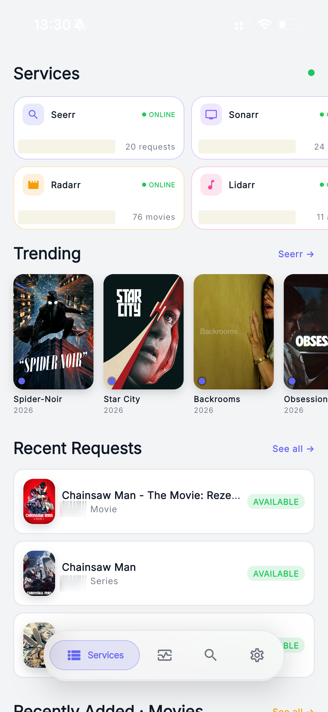
  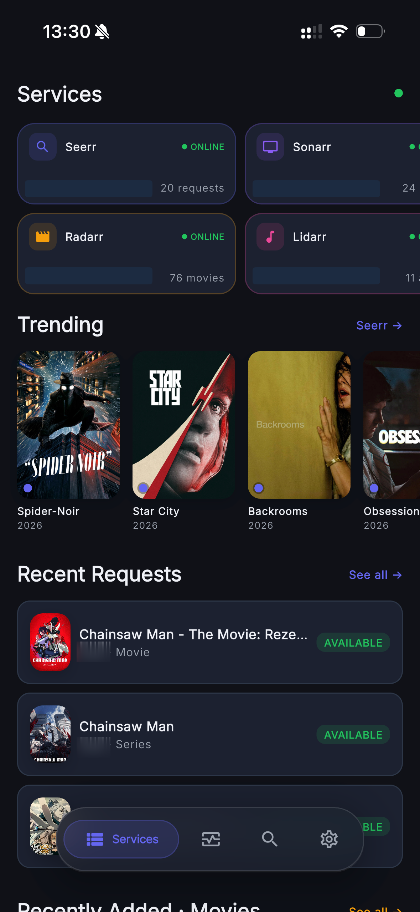
  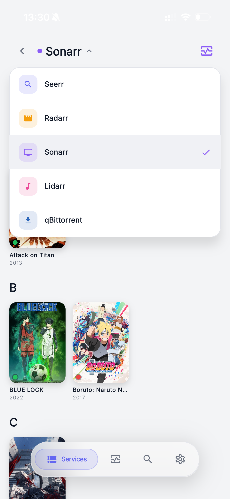
  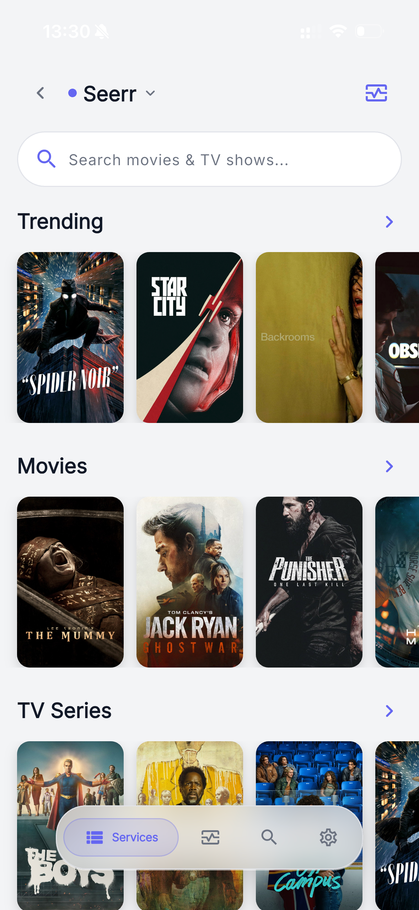
  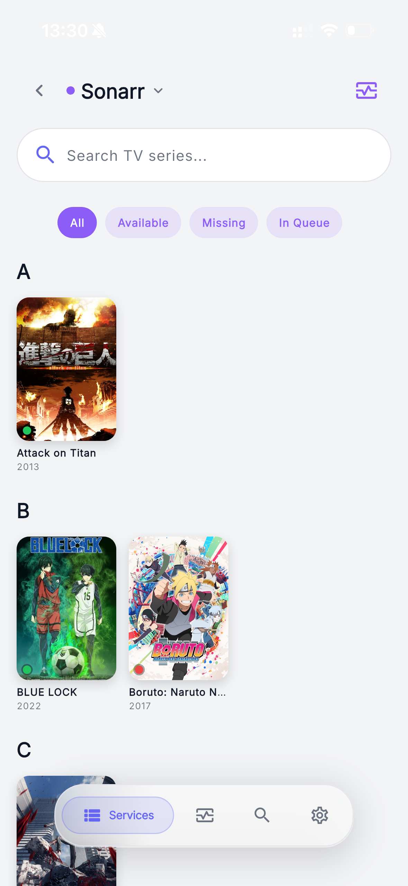
  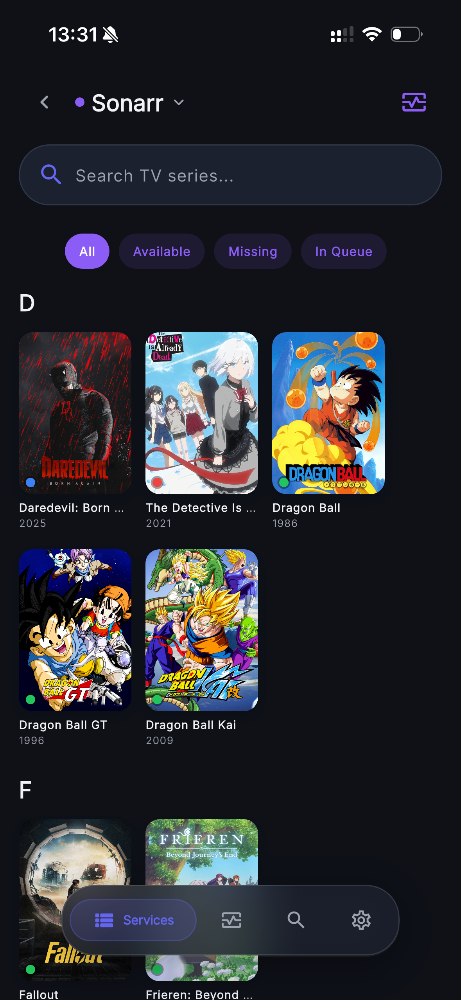

### Media details

  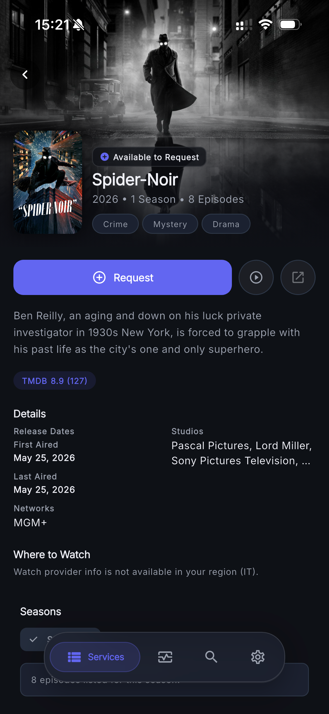
  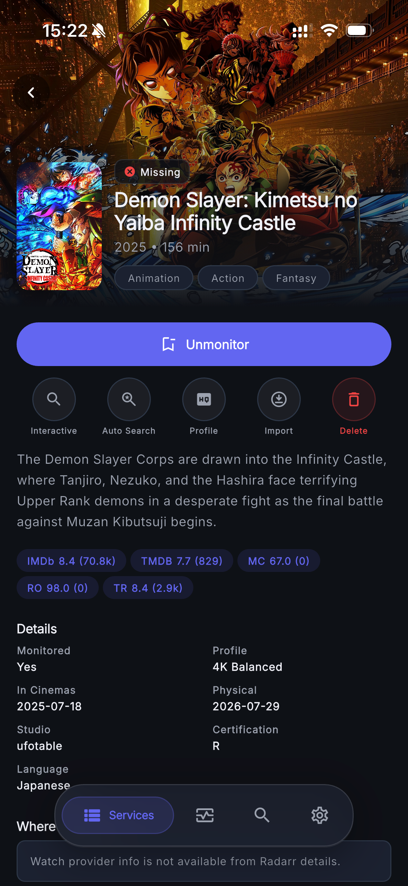

### Activity management

  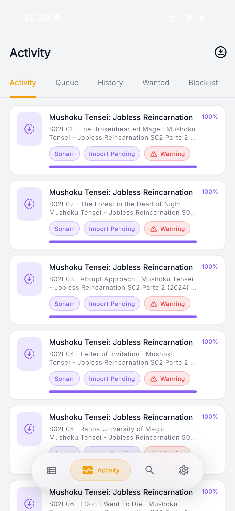

### Search & import

  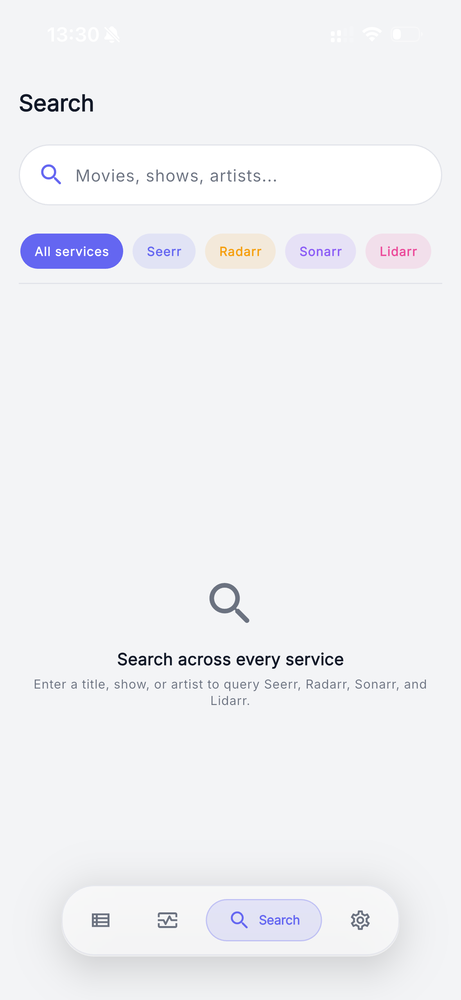
  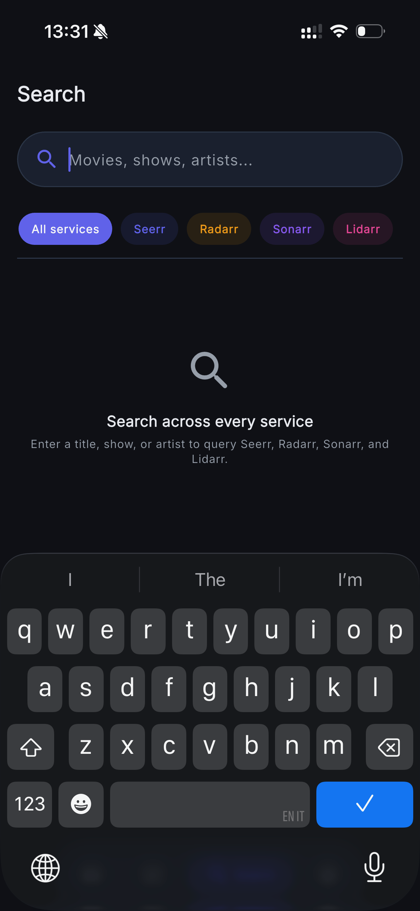
  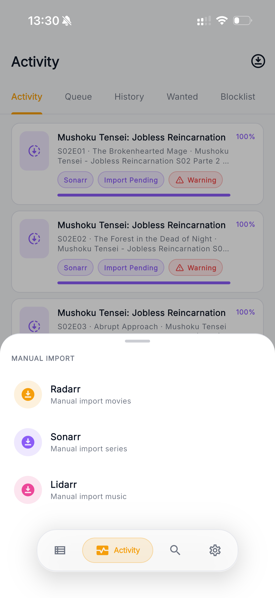

## Features

- **Discover** — Trending movies and TV via Seerr, rich detail pages,
  one-tap requests and interactive search
- **Movies / TV / Music** — Full Radarr, Sonarr and Lidarr library
  management: monitoring, quality profiles, delete-with-file, episode
  search
- **Torrents & Usenet** — qBittorrent and NZBGet: filters, sorting,
  live polling, pause/resume, categories and tags
- **Reviews & subtitles** — Bazarr companion management
- **Indexers** — Prowlarr release search with a grab sheet
- **Downloads & proxies** — NZBGet, Nginx Proxy Manager (certificate
  monitoring) and OpenMediaVault (system/disk monitoring)
- **Guest onboarding** — Wizarr invitations: view, create and revoke
- **Single sign-on** — One Authentik login covers Sonarr, Radarr and
  Prowlarr (short-lived tokens) with cookie sessions for SoulSync
- **Backup & restore** — Password-encrypted whole-config export
- **Android & iOS** — Tested on both; iOS via TrollStore sideloading

## Source availability

Beakarr is **MIT** licensed. The full source — including this release —
lives at https://github.com/wetw0rks-c0ding/Beakarr (per `LICENSE` /
`NOTICE.txt` here). You have the usual MIT rights to it.

## What to install, and what to expect

- Config (URLs, API keys) is stored on-device with `flutter_secure_storage`;
  nothing leaves your network except to your own services. No telemetry,
  nothing secret in the build.
- Android updates must be signed with the same key; an install from a
  dev/debug build won't let a release APK update over it — uninstall the
  dev build first.
- This project is device-tested per release; see the release notes for
  what was proven on which version.

## Support / issues

File bugs and feature requests on the source repository —
[wetw0rks-c0ding/Beakarr](https://github.com/wetw0rks-c0ding/Beakarr).
Do not paste credentials or personal data into public issues.

## License

MIT. Copyright (c) 2026 matthw-labs and Beakarr contributors.
Upstream [Seekarr by matthw-labs](https://github.com/matthw-labs/seekarr)
is credited; its license text is reproduced in `LICENSE`.
